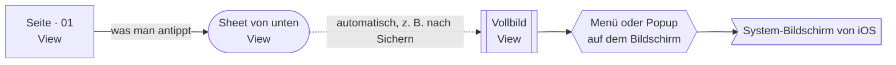
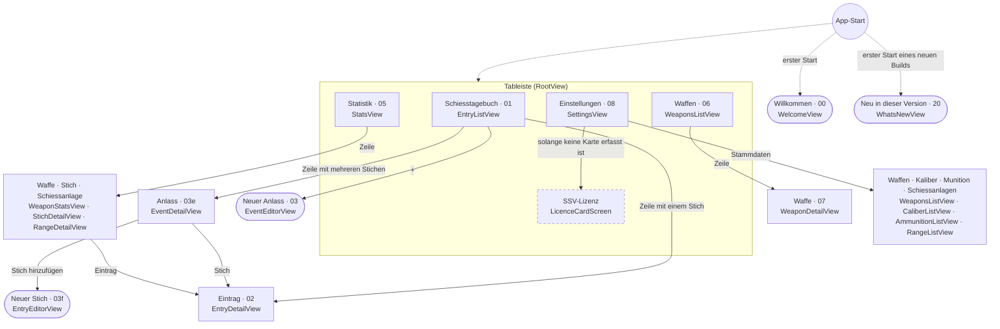
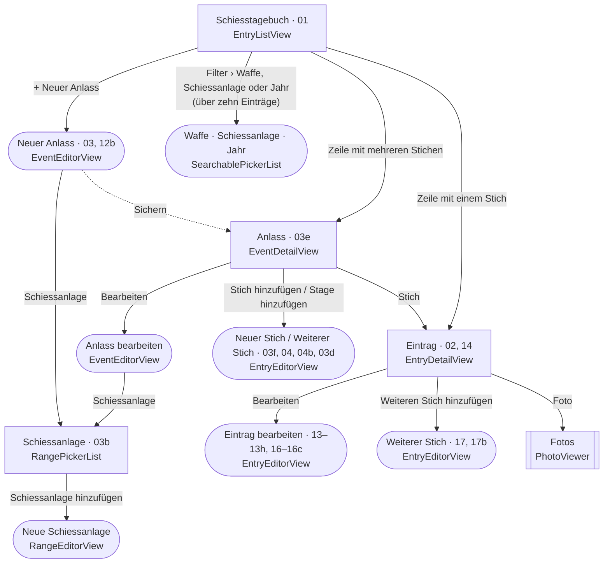
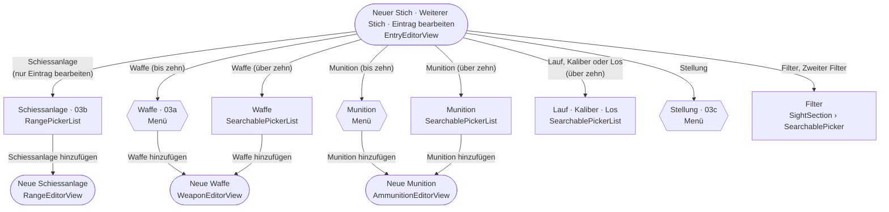
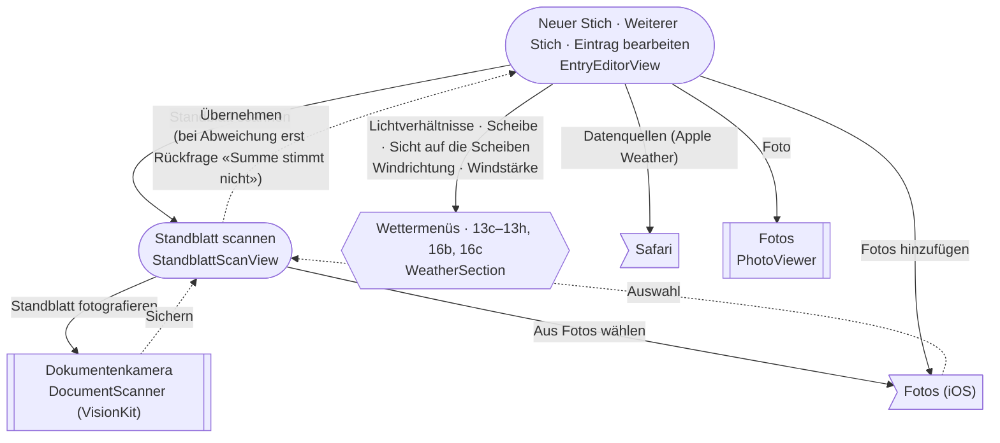
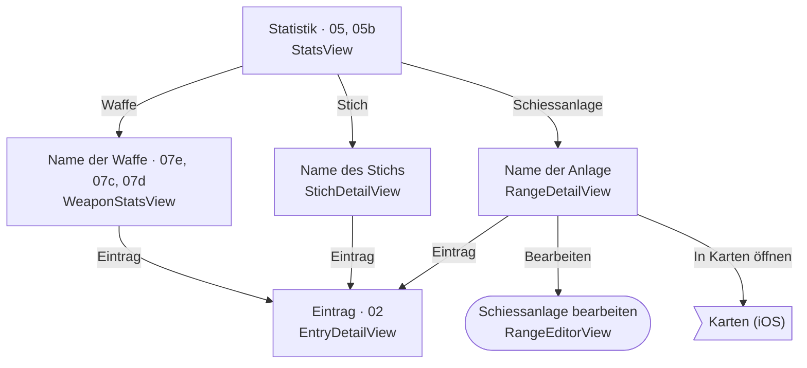
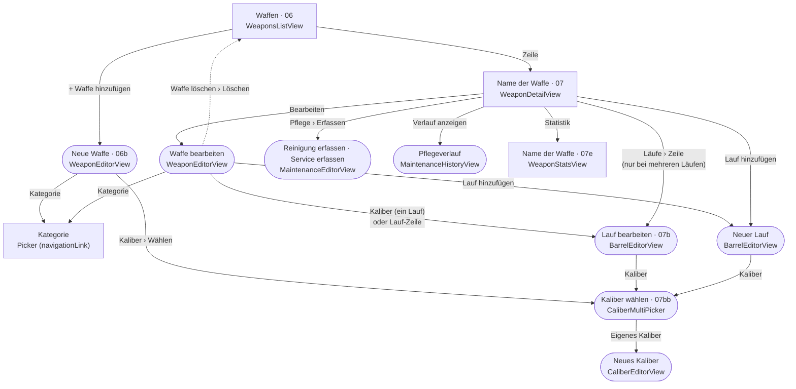
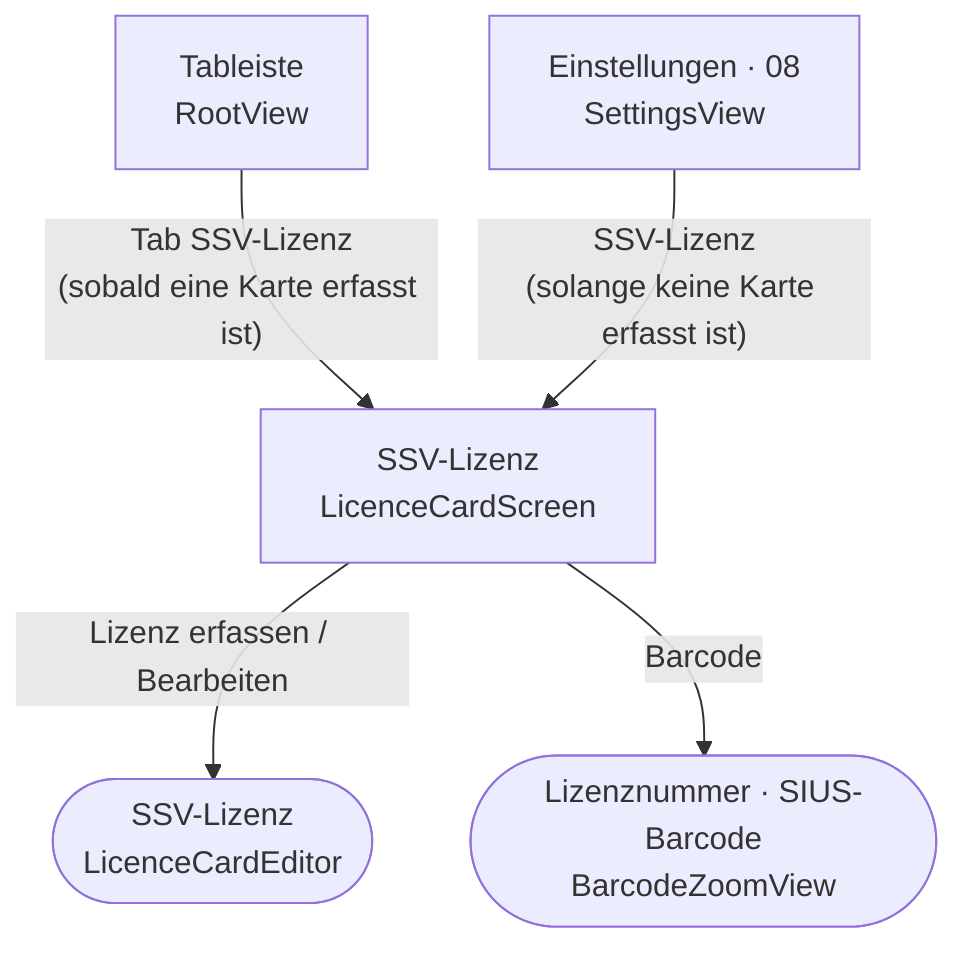
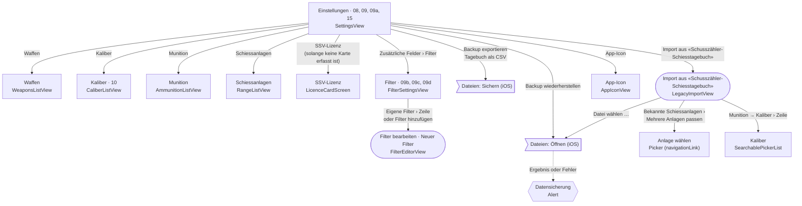
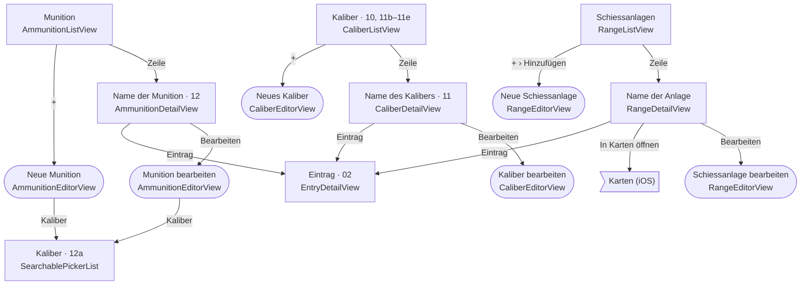

# Bildschirmfluss

Jeder Bildschirm der App und jeder Weg von einem zum nächsten, aus dem SwiftUI-Code in
`Schiesstagebuch/` gelesen (Stand: Branch `claude/screen-flow-72159a`). Die Diagramme sind
[Mermaid](https://mermaid.js.org/syntax/flowchart.html); GitHub zeichnet sie, und sie lassen
sich als Text bearbeiten.

## Lesehilfe

Jeder Knoten zeigt oben den Titel, den die App anzeigt, dahinter die Nummern der Stationen der
Screen-Tour (`SchiesstagebuchUITests/PRScreensTests.swift`, `snap("03a-…")`), unten den Namen
der SwiftUI-View. Die Tabelle [Bildschirme und Dateien](#bildschirme-und-dateien) führt zu den Dateien.

- **Rechteck**: eine Seite, die im Navigationsstapel geschoben wird («Zurück» oben links).
- **Abgerundet**: ein Sheet (Formular) von unten mit «Abbrechen» und «Sichern» oder «Fertig».
  Die Formulare lassen sich nicht wegwischen (`interactiveDismissDisabled`).
- **Doppelter Rand**: Vollbild (`fullScreenCover`).
- **Sechseck**: ein Menü oder Popup auf dem Bildschirm; nur gezeichnet, wo die Tour eine Station hat.
- **Fahne**: ein Bildschirm von iOS (Fotos, Dateien, Karten, Safari), nicht aus der App.
- **Pfeil mit Text**: was man antippt. **Gepunkteter Pfeil**: geht von selbst.
- «Löschen» öffnet auf jedem Detailbildschirm und in jedem Editor zuerst eine Rückfrage und führt
  dann auf den Bildschirm davor zurück; diese Pfeile sind nicht gezeichnet.
- Auswahlen mit bis zu zehn Einträgen sind Menüs, mit mehr als zehn eine geschobene Seite mit
  Suchfeld (`SearchablePickerList`, `PickerSearch.limit`). Wo beides vorkommen kann, stehen beide.

## Übersicht

Der Tab **SSV-Lizenz** erscheint erst, sobald eine Lizenz erfasst ist
(`SchiesstagebuchApp.swift`, `RootView`); davor steht dieselbe Seite unter Einstellungen.
Der Tab **Waffen** trägt eine Zahl, wenn Pflege fällig ist.

## Tagebuch

Die drei Stich-Formulare sind eine View (`EntryEditorView`): «Neuer Stich» für den ersten Stich
eines Anlasses, «Weiterer Stich» für jeden weiteren, «Eintrag bearbeiten» für einen bestehenden.
Nur «Eintrag bearbeiten» zeigt oben auch Datum, Schiessanlage und Anlass. Was im Formular selbst
aufgeht, zeigen die zwei nächsten Diagramme.

## Stich erfassen: Auswahlen

Lauf erscheint nur, wenn an dem Tag mehrere Läufe montiert waren; Kaliber nur bei einem Lauf
mit mehreren Kalibern; Los nur bei Munition mit Losnummern. Die Filterfelder nur, wenn sie unter
Einstellungen › Zusätzliche Felder eingeschaltet sind.

## Stich erfassen: Standblatt, Wetter, Fotos

Der Wetterblock erscheint nur mit eingeschaltetem Feld «Wetter»; «Von Apple Weather übernehmen»
füllt die Felder, ohne den Bildschirm zu wechseln.

## Statistik

Die Statistikseiten einer Waffe, eines Stichs, einer Schiessanlage, eines Kalibers und einer
Munition haben denselben Aufbau (`ItemStatsList` in `StatsView.swift`) und enden mit der Liste
ihrer Einträge.

## Waffen

Der Tab und die Seite Einstellungen › Waffen zeigen dieselbe Liste (`WeaponsListView`).

## SSV-Lizenz

## Einstellungen

Die Schalter und Auswahlen auf der Seite selbst (Bezeichnung, Erfassung, Standort, Wertungsarten,
Zusätzliche Felder, Erinnerungen) wechseln den Bildschirm nicht. Die Stammdaten-Listen zeigt das
nächste Diagramm, Waffen das Diagramm [Waffen](#waffen).

## Stammdaten

Die Katalog-Zeilen der Kaliberliste öffnen nichts; ein Kaliber aus dem Katalog kommt erst zu den
eigenen, wenn es für einen Lauf, eine Munition oder einen Eintrag gewählt wird. Das Menü «+» der
Schiessanlagen hat zusätzlich «Schweizer Schiessanlagen übernehmen», das sofort importiert und
nur eine Meldung zeigt.

## Bildschirme und Dateien

| Titel in der App | View | Datei | Art | Tour |
|---|---|---|---|---|
| Tableiste | `RootView` | `App/SchiesstagebuchApp.swift` | Tabs | – |
| Willkommen | `WelcomeView` | `Views/WelcomeView.swift` | Sheet beim ersten Start | 00 |
| Neu in dieser Version | `WhatsNewView` | `Views/WhatsNewView.swift` | Sheet bei einem neuen Build | 20 |
| Schiesstagebuch | `EntryListView` | `Views/EntryListView.swift` | Tab | 01 |
| Waffe · Schiessanlage · Jahr (Filter) | `SearchablePickerList` | `Views/SearchablePicker.swift` | Sheet | – |
| Anlass (Datum als Titel) | `EventDetailView` | `Views/EventDetailView.swift` | Seite | 03e |
| Neuer Anlass · Anlass bearbeiten | `EventEditorView` | `Views/EventDetailView.swift` | Sheet | 03, 12b |
| Schiessanlage (Auswahl) | `RangePickerList` | `Views/RangePicker.swift` | Seite im Sheet | 03b |
| Eintrag (Datum als Titel) | `EntryDetailView` | `Views/EntryDetailView.swift` | Seite | 02, 14 |
| Neuer Stich · Weiterer Stich · Eintrag bearbeiten | `EntryEditorView` | `Views/EntryEditorView.swift` | Sheet | 03f, 04, 04b, 03d, 13, 13b–13h, 16, 16b, 16c, 17, 17b |
| Waffe · Munition · Lauf · Kaliber · Los (Auswahl) | `SearchablePickerList` | `Views/SearchablePicker.swift` | Seite im Sheet | – (03a, 03c sind die Menüs) |
| Filter · Zweiter Filter (Auswahl) | `SightSection` › `SearchablePicker` | `Views/SightSection.swift` | Seite im Sheet | – |
| Standblatt scannen | `StandblattScanView` | `Views/StandblattScanView.swift` | Sheet | – |
| Dokumentenkamera | `DocumentScanner` | `Views/StandblattScanView.swift` | Vollbild | – |
| Fotos | `PhotoViewer` | `Views/PhotoGrid.swift` | Vollbild | – |
| Statistik | `StatsView` | `Views/StatsView.swift` | Tab | 05, 05b |
| Name der Waffe (Statistik) | `WeaponStatsView` | `Views/StatsView.swift` | Seite | 07e, 07c, 07d |
| Name des Stichs | `StichDetailView` | `Views/StatsView.swift` | Seite | – |
| Name der Anlage | `RangeDetailView` | `Views/StatsView.swift` | Seite | – |
| Name des Kalibers | `CaliberDetailView` | `Views/StatsView.swift` | Seite | 11 |
| Name der Munition | `AmmunitionDetailView` | `Views/StatsView.swift` | Seite | 12 |
| Waffen | `WeaponsListView` | `Views/WeaponViews.swift` | Tab, Seite | 06 |
| Name der Waffe | `WeaponDetailView` | `Views/StatsView.swift` | Seite | 07 |
| Neue Waffe · Waffe bearbeiten | `WeaponEditorView` | `Views/WeaponViews.swift` | Sheet | 06b |
| Kategorie | Picker in `WeaponEditorView` | `Views/WeaponViews.swift` | Seite im Sheet | – |
| Kaliber wählen | `CaliberMultiPicker` | `Views/WeaponViews.swift` | Sheet | 07bb |
| Neuer Lauf · Lauf bearbeiten | `BarrelEditorView` | `Views/BarrelViews.swift` | Sheet | 07b |
| Reinigung erfassen · Service erfassen | `MaintenanceEditorView` | `Views/WeaponViews.swift` | Sheet | – |
| Pflegeverlauf | `MaintenanceHistoryView` | `Views/WeaponViews.swift` | Sheet | – |
| SSV-Lizenz | `LicenceCardScreen` | `Views/LicenceCardView.swift` | Tab oder Seite | – |
| SSV-Lizenz (Formular) | `LicenceCardEditor` | `Views/LicenceCardView.swift` | Sheet | – |
| Lizenznummer · SIUS-Barcode | `BarcodeZoomView` | `Views/LicenceCardView.swift` | Sheet | – |
| Einstellungen | `SettingsView` | `Views/SettingsView.swift` | Tab | 08, 09, 09a, 15 |
| Kaliber | `CaliberListView` | `Views/SettingsView.swift` | Seite | 10, 11b–11e |
| Neues Kaliber · Kaliber bearbeiten | `CaliberEditorView` | `Views/SettingsView.swift` | Sheet | – |
| Munition | `AmmunitionListView` | `Views/SettingsView.swift` | Seite | – |
| Neue Munition · Munition bearbeiten | `AmmunitionEditorView` | `Views/SettingsView.swift` | Sheet | – |
| Kaliber (Auswahl der Munition) | `SearchablePickerList` | `Views/SearchablePicker.swift` | Seite im Sheet | 12a |
| Schiessanlagen | `RangeListView` | `Views/SettingsView.swift` | Seite | – |
| Neue Schiessanlage · Schiessanlage bearbeiten | `RangeEditorView` | `Views/SettingsView.swift` | Sheet | – |
| Filter | `FilterSettingsView` | `Views/FilterSettingsView.swift` | Seite | 09b, 09c, 09d |
| Neuer Filter · Filter bearbeiten | `FilterEditorView` | `Views/FilterSettingsView.swift` | Sheet | – |
| Import aus «Schusszähler-Schiesstagebuch» | `LegacyImportView` | `Views/LegacyImportView.swift` | Sheet | – |
| Anlage wählen (Import) | Picker in `LegacyImportView` | `Views/LegacyImportView.swift` | Seite im Sheet | – |
| Kaliber (Import) | `SearchablePickerList` | `Views/SearchablePicker.swift` | Seite im Sheet | – |
| App-Icon | `AppIconView` | `Views/AppIconView.swift` | Seite | – |

Die Tour hält ausserdem auf Menüs und Popups: 03a Waffe und 03c Stellung im Stich-Formular,
13c–13h, 16b und 16c die Wettermenüs im Stich-Formular.

### Bildschirme ohne Tour-Station

Diese Bildschirme erreicht keine Station der Screen-Tour; eine Änderung an ihnen zeigt der
PR-Kommentar «No visible change»:

- Filter-Sheet des Tagebuchs (Waffe · Schiessanlage · Jahr), die Auswahlseiten Waffe, Munition,
  Lauf, Kaliber, Los sowie Filter und Zweiter Filter im Stich-Formular
- Standblatt scannen und die Dokumentenkamera
- Fotos (PhotoViewer)
- Name des Stichs, Name der Anlage (Statistik)
- Kategorie (Picker der Waffe), Reinigung / Service erfassen, Pflegeverlauf
- SSV-Lizenz, ihr Formular und die Barcode-Ansicht
- Neues Kaliber / Kaliber bearbeiten, Munition (Liste), Neue Munition / Munition bearbeiten
  (die Tour öffnet beide, fotografiert aber nur die Kaliberauswahl 12a), Schiessanlagen (Liste),
  Neue Schiessanlage / Schiessanlage bearbeiten
- Neuer Filter / Filter bearbeiten
- Import aus «Schusszähler-Schiesstagebuch» mit seinen Auswahlseiten
- App-Icon
- Die Titel «Anlass bearbeiten» und «Waffe bearbeiten»: die Tour öffnet die Formulare nur neu
  (03, 06b) bzw. fotografiert im Bearbeiten-Modus nur Unterseiten (07b).

### Kein Bildschirm

Dateien unter `Schiesstagebuch/Views/`, die Bausteine innerhalb eines Bildschirms sind:

| Datei | Was darin steckt |
|---|---|
| `FilterHolderIcon.swift` | Symbol des Filterhalters |
| `Icons.swift` | Patronen-, Waffen- und Zweibein-Zeichnungen |
| `IPSCViews.swift` | Schalter, Picker und Abschnitte für IPSC in Anlass-, Stich-Formular und Eintrag |
| `NumberStepperRow.swift` | Zeile mit +/−, Menüeintrag mit Untertitel |
| `PasseTotalsRows.swift` | Zeilen «Passe» mit Schüssen und Punkten im Stich-Formular |
| `PickerValueRow.swift` | Formularzeile mit Menü und «… hinzufügen» (Waffe, Munition) |
| `RangeLocation.swift` | Ort mit Vorschlägen, Karte mit «In Karten öffnen», Schussrichtung |
| `RulerSlider.swift` | Lineal-Schieber für Iris, Ringkorn, Zweibeinstütze |
| `SearchablePicker.swift` | die Formularzeile; nur ihre Seite `SearchablePickerList` ist ein Bildschirm |
| `ShotBoxesRow.swift` | Felder der Einzelschüsse |
| `SightSection.swift` | Abschnitt «Einstellungen für Sportschützen» im Stich-Formular |
| `StatsComponents.swift` | Zeitraum, Kennzahlen und Diagramme der Statistikseiten |
| `WeatherSection.swift` | Wetterabschnitt im Stich-Formular und im Eintrag |
| `PhotoGrid.swift` | das Fotoraster; nur `PhotoViewer` darin ist ein Bildschirm |
| `RangePicker.swift` | `RangePickerRow` ist die Zeile; `RangePickerList` ist der Bildschirm |

## iPhone und iPad

Die App hat keinen eigenen Code für das iPad (`TARGETED_DEVICE_FAMILY: "1,2"` in `project.yml`,
keine Abfrage von `horizontalSizeClass` oder `userInterfaceIdiom`). Der Fluss ist auf beiden
gleich; nur iOS stellt ihn anders dar:

- Auf dem iPad zeichnet iPadOS die Tableiste oben statt unten (so sucht sie auch
  `SchiesstagebuchUITests/IPadScreensTests.swift`).
- Sheets erscheinen auf dem iPad als zentriertes Formular statt von unten; die halbe Höhe
  (`presentationDetents([.medium])` bei Neues Kaliber, Reinigung / Service erfassen,
  Neue Schiessanlage) gilt nur auf dem iPhone.
- Menüs öffnen auf dem iPad als Popover neben der Zeile.
- Vollbild (Fotos, Dokumentenkamera) füllt auf beiden den ganzen Bildschirm.

## Unsicher

Übergänge, die der Code nahelegt, die ich aber nicht sicher bestätigen konnte; sie fehlen in
den Diagrammen oder sind dort nur als Platzhalter gezeichnet:

1. **Pflege-Erinnerung antippen.** `Services/Maintenance.swift:143` plant lokale
   Mitteilungen; einen `UNUserNotificationCenterDelegate` gibt es nicht. Ein Tipp auf die
   Mitteilung öffnet also die App dort, wo sie war, nicht die Waffe. Ist das gewollt?
2. **Erste Lizenz aus den Einstellungen.** `Views/SettingsView.swift:44` schiebt die Seite
   SSV-Lizenz nur, solange keine Karte da ist. Nach «Sichern» der ersten Karte legt
   `App/SchiesstagebuchApp.swift:87` den Tab an und die Zeile in den Einstellungen verschwindet,
   während die geschobene Seite noch offen ist. Was der Nutzer dann sieht, habe ich nicht am Gerät
   geprüft.
3. **Lizenz löschen im eigenen Tab.** `Views/LicenceCardView.swift:272` löscht alle Karten; damit
   verschwindet der Tab, auf dem der Nutzer gerade steht (`App/SchiesstagebuchApp.swift:87`).
   Welcher Tab danach gezeigt wird, entscheidet iOS; nicht gezeichnet.
4. **Titel der geschobenen Picker-Seiten.** `Views/SightSection.swift:48` (Filter),
   `Views/WeaponViews.swift:277` (Kategorie) und `Views/LegacyImportView.swift:200` (Anlage wählen)
   nutzen `.pickerStyle(.navigationLink)`; die Seite trägt dann den Namen des Pickers. Die Knoten
   «Filter», «Kategorie» und «Anlage wählen» sind so angenommen, nicht am Gerät gesehen.
5. **Filter mit über zehn Einträgen.** `Views/SightSection.swift:46` übergibt die Filter an
   `SearchablePicker`; mit mehr als zehn sichtbaren Filtern wird daraus die Suchseite
   (`Views/SearchablePicker.swift:70`), sonst der Picker. Ob ein Nutzer beide Formen sieht, hängt
   von seinen Filtern ab; gezeichnet ist ein Knoten.
